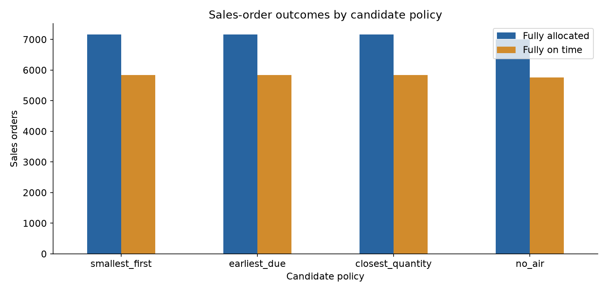

# Sea-to-Air Transfer Decision Support

[](https://github.com/Licheng1004/sea-to-air-transfer/actions/workflows/ci.yml)

Allocate inventory and purchase receipts to sales-order demand, then identify physical purchase lines worth switching from sea to air under monthly weight quotas.

**Portfolio owner:** Licheng Xiong. **Stack:** Python, pandas, Excel, deterministic allocation, matplotlib, Jupyter, automated verification.

## Results and evidence

For the fixed **2024-11-04** scenario and an assumed **7-day air transit**, the selected policy transfers **181 purchase lines / 10,185.873 kg**. Fully allocated sales orders increase from **7,008 to 7,160 (+152)**; fully on-time orders rise from **5,766 to 5,834 (+68)**. These are modeled scenario outcomes, not realized logistics savings.



[Executed analysis](analysis.ipynb) · [Allocation results](results/run_summary.json) · [Decision policy](config.json) · [Legacy audit](results/legacy_audit.json)

## Project work

The project consolidates my supplied allocation work into one deterministic implementation, correcting duplicate purchase lines, repeated inventory use, method eligibility, quota accounting and historical on-time logic. This repository's existing data manifest records the owner's release authorization; no additional files are introduced by the reproducibility update.

## Method

Candidate lines are evaluated against shared inventory and remaining physical PO quantities. Linked orders keep their original purchase-line restrictions. Demand is allocated by priority and deadline, with one material-level forecast buffer. A transferred line consumes its whole weight once against its entity/month quota. Conflicting PO schedules are quarantined. The policy compares closest quantity, largest quantity, smallest quantity and no-air behavior on identical inputs.

## Reproduce the project

Install [uv](https://docs.astral.sh/uv/getting-started/installation/), then clone this repository. The committed `.python-version` selects Python 3.12.14; `pyproject.toml` and `uv.lock` lock the direct and transitive Python dependencies. First installation requires internet access.

```sh
git clone https://github.com/Licheng1004/sea-to-air-transfer.git
cd sea-to-air-transfer
uv sync --locked
uv run --locked python transfer.py --output-dir .reproduction
```


### Verify the installation and published evidence

```sh
uv run --locked python scripts/verify.py
uv run --locked python -m unittest -v test_transfer.py
```

`--locked` rejects stale project metadata instead of silently changing the dependency versions. Select `.venv` as the Jupyter kernel in VS Code. Notebook path detection supports execution from the repository root or a notebook subdirectory. Runtime installation and synthetic checks do not reproduce a private-data competition score.

See [the reproducibility record](REPRODUCIBILITY.md) for the actual checks performed, their scope and any external prerequisites.

## Data and outputs

The four required workbooks are retained under `data/`: `Open PO.xlsx`, `Open SO.xlsx`, `Material List.xlsx` and `Quota.xlsx`. Their source/stored hashes and existing release authorization are recorded in [data_manifest.json](data_manifest.json). The default policy and historical date are frozen in `config.json`.

The public clone contains the required inputs and saved results. The quick command retrains/recomputes in `.reproduction/`, preserving the published `results/`. Tests independently reconcile the retained results and check quota, inventory, purchase-line conservation, order links and timing. Use `uv run --locked python -m jupyterlab` to inspect `analysis.ipynb`; rerunning it can overwrite plots in `results/`.

## Repository map

| Path | Purpose |
| --- | --- |
| `transfer.py` | Maintained executable pipeline |
| `config.json` | Frozen assumptions and selected policy |
| `analysis.ipynb` | Reviewable analysis and retained outputs |
| `data/`, `data_manifest.json` | Required inputs and preservation evidence |
| `results/` | Comparison, audit and generated-result evidence |
| `test_transfer.py` | Independent regression checks |

## Limits and reuse

This is a greedy comparison among three candidate orderings, not a proof of global optimality. Transit duration is an assumption; no cost, customs or service-level model is included. Overdue orders cannot become historically on time after the scenario date. The evidence supports the supplied snapshot and documented assumptions. No new reuse license is granted.
